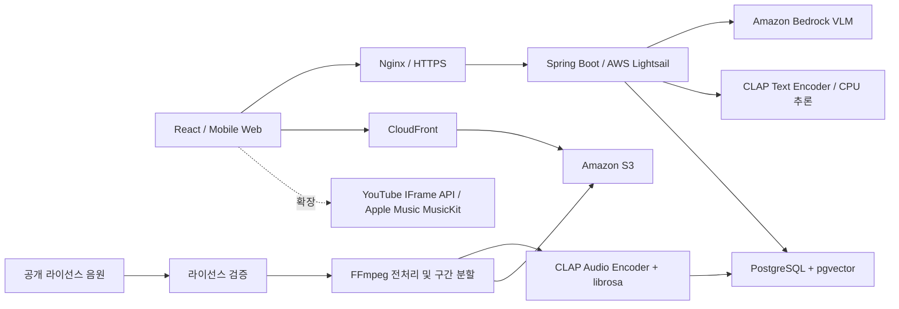
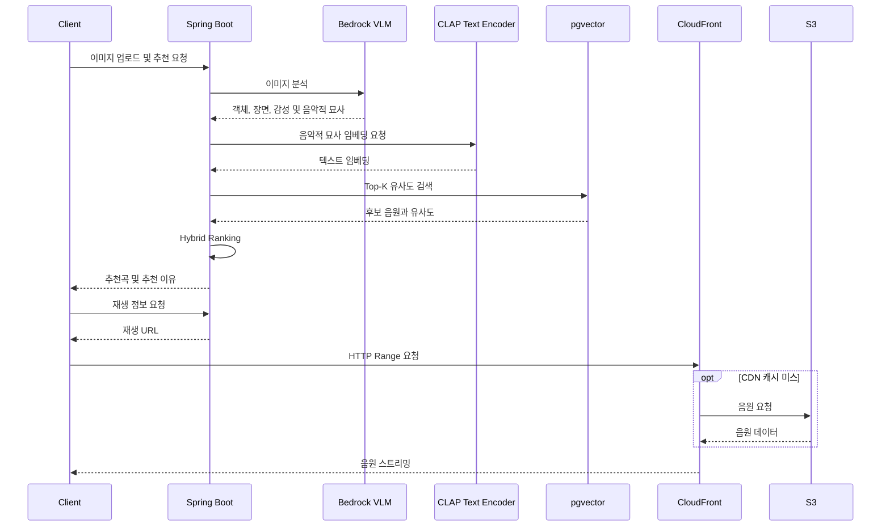

# 이미지 기반 클래식 음악 추천 및 스트리밍 서비스

**서비스 기획안 및 시스템 아키텍처 v0.1** · 초안

이미지의 장면과 분위기를 실제 클래식 녹음의 음향 특성과 연결해 음악을 추천하는 웹 서비스다. 추천 엔진과 재생 플랫폼을 분리하고, 초기 월 운영비는 3~5만 원을 목표로 한다.

## 1. 프로젝트 개요

| 항목        | 내용                                  |
| --------- | ----------------------------------- |
| 프로젝트명     | 미정                                  |
| 서비스 유형    | 멀티모달 AI 기반 음악 추천                    |
| 주요 콘텐츠    | 클래식 음악                              |
| 핵심 기능     | 이미지 인식, 객체 추출, 감성 분석, 음악 추천, 스트리밍   |
| 서비스 플랫폼   | Web / Mobile Web                    |
| 백엔드       | Java, Spring Boot                   |
| 인프라       | AWS                                 |
| AI 기술     | VLM, CLAP, Vector Similarity Search |
| 목표 운영비    | 월 3~5만 원                           |
| 초기 목표 사용자 | MAU 1,000명 (가정)                     |

## 2. 서비스 기획

### 2.1 서비스 배경

기존 음악 추천 서비스는 사용자의 청취 이력, 선호 장르, 검색 기록 등을 중심으로 음악을 추천한다.

본 서비스는 사용자가 촬영하거나 업로드한 이미지에서 객체, 장면, 색감, 분위기 등의 정보를 추출하고, 해당 이미지와 감성적으로 어울리는 클래식 음악을 추천한다.

클래식 음악은 작품, 악장, 연주자에 따라 서로 다른 음향적 특성과 감성을 가지므로 세밀한 분위기 기반 추천에 활용할 수 있다.

### 2.2 서비스 목표

- 이미지 기반의 직관적인 음악 탐색 경험 제공
- 클래식 음악에 대한 진입 장벽 완화
- 실제 음원의 음향적 특성을 활용한 음악 추천
- 추천부터 음악 감상까지 서비스 내부에서 제공
- 특정 음악 플랫폼에 종속되지 않는 추천 시스템 구축

### 2.3 주요 사용자

- 클래식 음악에 관심이 있지만 곡명이나 작곡가를 잘 모르는 사용자
- 사진, 여행, 풍경, 미술 작품에 어울리는 음악을 감상하고 싶은 사용자
- 현재 기분이나 주변 환경에 어울리는 음악을 탐색하는 사용자

### 2.4 핵심 사용자 경험

1. 사용자가 사진을 촬영하거나 업로드한다.
2. AI가 이미지의 객체, 장면 및 분위기를 분석한다.
3. 이미지와 어울리는 클래식 음악을 추천한다.
4. 추천 이유와 작품 정보를 제공한다.
5. 서비스 내부에서 음악을 재생한다.
6. 사용자는 음악을 저장하거나 추천 결과에 피드백을 남긴다.

## 3. 경쟁 서비스 및 차별화

| 항목            | 기존 이미지 기반 추천 서비스 | 본 서비스 목표 |
| ------------- | ---------------- | -------- |
| 이미지 인식        | 지원               | 지원       |
| 분위기 기반 추천     | 지원               | 지원       |
| 클래식 특화        | 일부 지원            | 지원       |
| 실제 음원 임베딩     | 내부 구현 미공개        | 지원       |
| 악장 단위 추천      | 확인 필요            | 지원       |
| 연주 버전별 추천     | 확인 필요            | 지원       |
| 구간별 음향 분석     | 확인 필요            | 지원       |
| 자체 스트리밍       | 서비스별 상이          | 지원       |
| 외부 음악 플랫폼 연동  | 일부 지원            | 지원       |
| 추천 알고리즘 비교 평가 | 미공개              | 지원       |

주요 비교 대상은 ClassicalLens, 플더픽, SoundLens 등이다.

기존 서비스의 내부 추천 알고리즘이 공개되지 않았으므로 기술적 우위는 실제 구현 및 비교 평가를 통해 검증한다.

**핵심 차별화 전략:** 음악의 제목이나 설명만 분석하는 것이 아니라, 실제 녹음 음원의 음향적 특징과 이미지의 감성 정보를 활용하는 추천 엔진을 구축한다.

## 4. 기능 요구사항

| ID    | 기능              | 우선순위 |
| ----- | --------------- | ---- |
| FR-01 | 이미지 업로드         | P0   |
| FR-02 | 이미지 객체 및 장면 추출  | P0   |
| FR-03 | 이미지 감성 분석       | P0   |
| FR-04 | 음악 임베딩 생성       | P0   |
| FR-05 | 벡터 유사도 기반 음악 추천 | P0   |
| FR-06 | 추천 이유 제공        | P0   |
| FR-07 | 클래식 작품·악장 정보 조회 | P0   |
| FR-08 | 자체 음원 스트리밍      | P0   |
| FR-09 | 외부 음악 플랫폼 링크 제공 | P1   |
| FR-10 | 사용자 인증          | P1   |
| FR-11 | 추천 기록 및 즐겨찾기    | P1   |
| FR-12 | 감성 가중치 조절       | P1   |
| FR-13 | 외부 음악 플랫폼 내부 재생 | P1   |
| FR-14 | 사용자 취향 기반 개인화   | P2   |
| FR-15 | 연주 버전별 추천       | P2   |
| FR-16 | 음악 플레이리스트 생성    | P2   |
| FR-17 | 추천 성능 평가 및 분석   | P1   |

P0는 MVP 필수, P1은 초기 서비스 확장, P2는 고도화 범위다.

## 5. 비기능 요구사항

| 영역        | 초기 목표                    |
| --------- | ------------------------ |
| 추천 응답시간   | p95 5초 이내                |
| 음악 재생 시작  | p95 2초 이내                |
| 서비스 가용성   | 월 99.5% 목표               |
| 초기 음원 규모  | 1,000~3,000개 녹음 음원      |
| 월간 이미지 분석 | 10,000건                  |
| 월간 음악 재생  | 50,000회                  |
| 확장성       | API, 추론, DB 독립 확장 가능 구조  |
| 보안        | HTTPS, IAM 최소 권한, 업로드 검증 |
| 개인정보      | 이미지 EXIF 제거 및 저장 최소화     |
| 비용        | 월 3~5만 원 목표             |
| 관측 가능성    | 요청량, 지연시간, 오류율, 비용 모니터링  |

성능 및 가용성 수치는 초기 설계 목표이며 실제 부하 테스트를 통해 조정한다.

## 6. 음악 데이터 확보 전략

### 6.1 데이터 소스

| 데이터 소스                   | 용도             |
| ------------------------ | -------------- |
| Wikimedia Commons        | 공개 라이선스 클래식 음원 |
| Musopen                  | 클래식 녹음 음원 후보   |
| IMSLP                    | 작품 및 녹음 정보     |
| Open Goldberg Variations | CC0 피아노 음원     |
| Internet Archive         | 역사적 녹음 음원 후보   |
| MusicBrainz              | 작곡가 및 작품 메타데이터 |
| AcousticBrainz           | 기존 음향 분석 데이터   |
| DEAM                     | 감성 분석 및 평가 데이터 |

### 6.2 라이선스 관리

자체 스트리밍 및 임베딩은 이용 권한이 확인된 음원으로 한정한다.

- Public Domain 및 CC0 우선 수집
- CC BY 음원은 저작자 표시 조건 준수
- CC BY-NC 음원은 초기 서비스에서 제외
- 작곡 저작권과 실제 녹음의 저작인접권을 구분
- 국가별 권리 상태 및 데이터 제공처의 이용약관 검증
- 원본 출처, 라이선스 URL, 수집 일자, 권리 증빙 저장

### 6.3 음악 재생 전략

| 재생 방식                | 역할            | 도입 단계 |
| -------------------- | ------------- | ----- |
| 자체 S3 + CloudFront   | 기본 음악 재생      | MVP   |
| YouTube IFrame API   | 자체 미보유 음원 재생  | 확장    |
| Apple Music MusicKit | 구독자 대상 완곡 재생  | 확장    |
| Spotify 외부 링크        | 외부 플랫폼 연결     | 확장    |
| Spotify Playback SDK | 정책 및 접근 조건 검토 | 보류    |

외부 플랫폼 음원은 직접 다운로드하거나 임베딩하지 않는다. 공식 재생 인터페이스를 사용하며, 이미지와 음악을 함께 제공하는 서비스 형태가 플랫폼 정책에 부합하는지 별도 검증한다.

## 7. AI 추천 시스템 설계

### 7.1 이미지 분석 파이프라인

Vision Language Model을 활용하여 다음 정보를 추출한다.

| 분석 항목   | 데이터 예시             |
| ------- | ------------------ |
| 객체      | 바다, 산, 나무, 사람      |
| 장면      | 해변, 도시, 숲          |
| 시간적 특성  | 새벽, 낮, 노을, 밤       |
| 시각적 특성  | 밝기, 채도, 색감         |
| 분위기     | 평온함, 웅장함, 몽환적      |
| Valence | 긍정·부정 감성           |
| Arousal | 감성 활성도             |
| 음악적 묘사  | 느린 템포의 부드러운 피아노 음악 |

별도의 YOLO 서버는 초기 단계에서 제외하고 VLM을 통해 객체 및 분위기 정보를 함께 추출한다.

### 7.2 음악 분석 파이프라인

음악 데이터는 사용자 요청 이전에 배치 작업을 통해 분석한다.

1. 음원 수집 및 라이선스 검증
2. FFmpeg 기반 오디오 전처리
3. 작품 및 악장 단위 메타데이터 추출
4. 10~30초 단위 오디오 구간 분할
5. CLAP Audio Encoder 기반 임베딩 생성
6. librosa 등을 활용한 템포, 에너지, 음색 분석
7. Vector DB 저장
8. 스트리밍용 음원 S3 저장

### 7.3 멀티모달 임베딩 전략

이미지에서 추출한 감성 및 음악적 묘사를 CLAP Text Encoder에 입력한다.

음악 데이터는 CLAP Audio Encoder를 통해 동일한 임베딩 공간으로 변환한다.

이를 통해 이미지에서 유도한 음악적 묘사와 실제 음원의 벡터 간 유사도를 계산한다.

일반적인 이미지 임베딩과 오디오 임베딩을 서로 다른 벡터 공간에서 직접 비교하지 않는다.

### 7.4 추천 알고리즘

초기 추천 점수는 다음 요소를 결합하여 계산한다.

Score = 0.7 × 감성 유사도 + 0.2 × 장면 유사도 + 0.1 × 사용자 선호도

- 감성 유사도: CLAP 기반 텍스트·오디오 유사도
- 장면 유사도: 이미지 문맥과 음악의 독립적인 분위기 태그 비교
- 사용자 선호도: 좋아요, 재생 완료, 스킵 등의 피드백

초기 사용자의 선호 정보가 없는 경우 감성 및 장면 점수만 재정규화하여 적용한다.

가중치는 초기 실험값이며 추천 품질 평가를 통해 최적화한다.

### 7.5 추천 모델 비교 실험

| 모델                          | 역할                 |
| --------------------------- | ------------------ |
| VLM + LLM 직접 추천             | Baseline A         |
| VLM + Text Embedding        | Baseline B         |
| VLM + CLAP                  | Main Model         |
| ImageBind                   | Experimental Model |
| CLAP + 음향 특성 Hybrid Ranking | Advanced Model     |

CLAP과 ImageBind가 클래식 음악의 감성을 충분히 표현하는지는 실험을 통해 검증한다.

## 8. 시스템 아키텍처

### 8.1 논리적 아키텍처

| 계층                   | 구성 요소                                   |
| -------------------- | --------------------------------------- |
| Presentation         | React, HTML5 Audio, Media Session API   |
| API                  | Spring Boot REST API                    |
| Authentication       | Spring Security, OAuth 2.0              |
| Recommendation       | Recommendation Service, Hybrid Ranking  |
| AI Inference         | Amazon Bedrock, CLAP Text Encoder       |
| Data                 | PostgreSQL, pgvector                    |
| Object Storage       | Amazon S3                               |
| Streaming            | Amazon CloudFront                       |
| Batch Processing     | Python, FFmpeg, CLAP Audio Encoder      |
| External Integration | YouTube, Apple Music Adapter            |
| Observability        | CloudWatch, Spring Actuator, Micrometer |
| CI/CD                | GitHub Actions, Docker                  |

### 8.2 이미지 추천 요청 흐름

Client → Spring Boot → Bedrock VLM → CLAP Text Encoder → pgvector → Hybrid Ranking → Client

### 8.3 음악 스트리밍 흐름

Client → Spring Boot 재생 권한 및 URL 조회 → CloudFront → S3

실제 음악 데이터는 백엔드 서버를 경유하지 않고 CDN을 통해 전달한다.

### 8.4 음원 수집 및 분석 흐름

Music Source → License Validation → FFmpeg → Audio Segmentation → CLAP Audio Encoder → PostgreSQL / S3

오디오 임베딩 생성은 로컬 또는 배치 인프라에서 수행하며, 실시간 API 요청과 분리한다.

### 8.5 서비스 모듈 구조

| 모듈             | 책임                 |
| -------------- | ------------------ |
| Image Analysis | 이미지 검증 및 VLM 호출    |
| Recommendation | 후보 검색, 점수 계산, 정렬   |
| Music Catalog  | 작곡가, 작품, 악장, 음원 관리 |
| Playback       | 재생 URL 및 플랫폼 연동    |
| User           | 인증, 사용자 설정         |
| Feedback       | 좋아요, 스킵, 추천 평가     |
| Ingestion      | 음원 수집 및 메타데이터 관리   |
| License        | 음원 권리 및 출처 관리      |

초기에는 Spring Boot 기반 Modular Monolith로 구현한다. 서비스 규모 및 병목에 따라 추론, 배치, 추천 모듈을 독립적으로 분리한다.

## 9. 데이터베이스 설계

| Entity          | 주요 데이터           |
| --------------- | ---------------- |
| User            | 사용자 정보, 선호 설정    |
| Image           | 이미지 식별자, 저장 위치   |
| ImageAnalysis   | 객체, 장면, 감성 분석 결과 |
| Composer        | 작곡가 정보           |
| Work            | 작품명, 작품번호, 작곡가   |
| Movement        | 악장명, 악장 순서       |
| Recording       | 연주자, 연주 버전, 재생시간 |
| AudioSegment    | 음원 구간 시작·종료 시간   |
| Embedding       | 벡터, 모델명, 모델 버전   |
| License         | 권리 유형, 출처, 이용 조건 |
| ProviderMapping | 외부 플랫폼 음원 ID     |
| Recommendation  | 추천 결과 및 점수       |
| Feedback        | 좋아요, 스킵, 사용자 평가  |

클래식 음악은 하나의 작품에 여러 악장과 여러 녹음 버전이 존재한다. 단일 악장 작품도 표현할 수 있도록 설계하고, 작품과 실제 녹음 음원을 별도로 관리한다.

임베딩 모델 변경 시 재생성 및 비교가 가능하도록 모델 버전을 기록한다.

## 10. API 초안

| Method | Endpoint                     | 역할           |
| ------ | ---------------------------- | ------------ |
| POST   | /api/v1/images               | 이미지 업로드      |
| POST   | /api/v1/recommendations      | 음악 추천 요청     |
| GET    | /api/v1/recommendations/{id} | 추천 결과 조회     |
| GET    | /api/v1/tracks/{id}          | 음원 상세 조회     |
| GET    | /api/v1/tracks/{id}/playback | 재생 정보 조회     |
| GET    | /api/v1/works/{id}           | 클래식 작품 정보 조회 |
| GET    | /api/v1/composers/{id}       | 작곡가 정보 조회    |
| POST   | /api/v1/feedback             | 추천 피드백 등록    |
| GET    | /api/v1/users/me/history     | 추천 기록 조회     |
| POST   | /api/v1/users/me/favorites   | 즐겨찾기 등록      |

추천 요청은 초기에는 동기 방식으로 구현한다. 모델 지연시간 및 동시 요청량에 따라 SQS 기반 비동기 처리 구조로 확장한다.

## 11. AWS 인프라 설계

### 11.1 MVP 구성

| AWS 서비스               | 역할                      |
| --------------------- | ----------------------- |
| Lightsail 4GB         | Spring Boot, Nginx      |
| PostgreSQL + pgvector | Lightsail 내부 DB         |
| Amazon Bedrock        | VLM 이미지 분석              |
| AWS Lambda            | CLAP Text Encoder 추론 후보 |
| Amazon S3             | 음원 및 정적 리소스 저장          |
| Amazon CloudFront     | 음원 및 프론트엔드 전송           |
| Route 53              | DNS 관리                  |
| CloudWatch            | 로그 및 모니터링               |

CLAP Text Encoder의 Lambda 배포 가능 여부는 모델 크기, 메모리, Cold Start 및 실제 CPU 추론 시간을 측정한 후 결정한다.

### 11.2 확장 전략

- Lightsail에서 EC2 또는 ECS로 전환
- PostgreSQL을 RDS로 분리
- SQS 기반 비동기 추천 및 배치 작업 처리
- Redis 기반 이미지 분석 및 추천 결과 캐싱
- 추론 서버 독립 배포 및 수평 확장
- pgvector HNSW 인덱스 적용
- 음원 분석 파이프라인을 AWS Batch로 확장
- Multi-AZ 및 Load Balancer 도입

초기부터 EKS, GPU Endpoint, NAT Gateway 등을 도입하지 않는다.

## 12. 운영 비용 추정

월 운영비는 다음 사용량과 단가를 가정해 산정했다.

- MAU 1,000명
- 이미지 분석 월 10,000건
- 음악 재생 월 50,000회
- 음원 3,000개
- 평균 재생시간 8분
- MP3 192kbps
- 환율 1달러당 1,500원 가정

| 항목             | 월 예상 비용           |
| -------------- | ----------------- |
| Lightsail 4GB  | $24               |
| Bedrock 이미지 분석 | 약 $2              |
| Lambda 추론      | $0~2             |
| S3 음원 저장       | 약 $1              |
| CloudFront     | 무료 사용량 내 $0       |
| DNS, 로그, 백업    | $1~3             |
| 합계             | $28~32           |
| 한화 환산          | 약 42,000~48,000원 |

세금, 도메인 등록비, 유료 음원 확보 비용은 제외한다. CloudFront 무료 사용량 초과, 추론 리소스 증설 및 실제 API 사용량에 따라 비용이 증가할 수 있다.

## 13. 추천 성능 평가

| 평가 지표                   | 평가 목적            |
| ----------------------- | ---------------- |
| Precision@K            | 상위 추천곡의 적합도      |
| NDCG@K                 | 추천 순위의 품질        |
| Human Mood Rating       | 이미지와 음악의 감성적 일치도 |
| Diversity@K            | 추천곡의 다양성         |
| Skip Rate               | 사용자 추천 불만족 추정    |
| Playback Completion     | 음악 감상 유지율        |
| p95 Latency             | 추천 응답 성능         |
| Cost per Recommendation | 추천 1건당 비용        |

풍경, 도시, 자연, 건축, 인물 등으로 이미지 평가 데이터셋을 구성한다.

여러 평가자가 이미지와 추천곡의 감성적 적합도를 평가하고, LLM 직접 추천과 CLAP 기반 추천의 품질을 비교한다.

## 14. 개발 로드맵

| 단계      | 주요 작업             | 산출물          |
| ------- | ----------------- | ------------ |
| Phase 0 | 라이선스 조사, 모델 PoC   | 기술 검증 보고서    |
| Phase 1 | 음원 확보, DB 및 배치 구축 | 음악 데이터 파이프라인 |
| Phase 2 | 이미지 분석 및 벡터 검색    | 추천 API       |
| Phase 3 | 프론트엔드 및 자체 스트리밍   | MVP          |
| Phase 4 | 인증, 기록, 외부 플랫폼 연동 | 서비스 확장       |
| Phase 5 | 추천 모델 비교 및 개인화    | 추천 성능 평가 보고서 |
| Phase 6 | 부하 테스트 및 비용 최적화   | 운영 아키텍처      |

## 15. 주요 리스크

| 리스크               | 대응 전략                        |
| ----------------- | ---------------------------- |
| 음원 저작권 및 저작인접권    | 음원별 권리 검증 및 증빙 관리            |
| 클래식 음원 확보 부족      | 공개 라이선스 음원 중심 확보             |
| CLAP 추천 정확도 부족    | Baseline 비교 및 Hybrid Ranking |
| 이미지 분석 지연         | 이미지 축소, 타임아웃, 비동기 처리         |
| Lambda Cold Start | 모델 경량화, 별도 CPU 추론 서버 검토      |
| 외부 플랫폼 정책 변경      | Music Provider Adapter 분리    |
| 플랫폼 간 연주 버전 불일치   | 작품·악장·연주자 기반 매핑              |
| 스트리밍 비용 증가        | CDN 캐싱, 전송량 모니터링             |
| 이미지 개인정보 노출       | EXIF 제거, 단기 보관, 접근 제어        |
| 단일 서버 장애          | 백업 및 복구 절차, 추후 DB 분리         |

## 16. 최종 프로젝트 방향

이미지 인식, 실제 음원 분석, 멀티모달 벡터 검색 및 음악 스트리밍을 결합한 클래식 음악 탐색 서비스를 구축한다.

단순 LLM 기반 추천을 넘어 독립적인 음악 데이터 파이프라인과 추천 엔진을 구현하며, 외부 음악 플랫폼과 자체 음원 스트리밍을 유연하게 결합할 수 있는 구조를 지향한다.

## 17. 전체 시스템 아키텍처

외부 플랫폼 재생은 공식 인터페이스로 클라이언트에서 처리한다. 자체 음원은 CloudFront를 통해 클라이언트에 전달한다.

## 18. 추천 및 재생 시퀀스

## 19. Phase 0 기술 검증 체크리스트

- [ ] 공개 라이선스 클래식 음원 100곡을 확보하고 다운로드, 분석, 재배포 권한을 확인한다.
- [ ] CLAP Audio Encoder로 곡 단위와 구간 단위 임베딩을 비교한다.
- [ ] VLM과 CLAP Text Encoder를 연결해 이미지에서 추출한 감성과 실제 음원의 유사도를 검증한다.
- [ ] LLM 직접 추천과 CLAP 기반 추천을 비교해 추천 품질과 사용자 평가를 측정한다.
- [ ] CPU 추론과 스트리밍을 벤치마크해 응답시간, 메모리, 콜드 스타트, 운영비를 확인한다.

## 20. 설계 의사결정 요약

| 설계 대상     | 초기 채택                          | 추후 확장               |
| --------- | ------------------------------ | ------------------- |
| 아키텍처      | Modular Monolith               | MSA                 |
| 이미지 분석    | Bedrock VLM                    | 자체 VLM 서빙           |
| 음악 분석     | 오프라인 CLAP                      | 분산 Batch Pipeline   |
| 추천        | Vector Search + Hybrid Ranking | 개인화 추천              |
| Vector DB | pgvector                       | 독립 Vector DB        |
| 메시지 처리    | 동기 REST                        | SQS 비동기 처리          |
| 음악 재생     | HTTP Range Request             | HLS 검토              |
| 음원 저장     | S3                             | S3 + Lifecycle      |
| 데이터 전송    | CloudFront                     | CDN 최적화             |
| 컴퓨팅       | Lightsail                      | ECS / EC2           |
| DB 운영     | Self-managed PostgreSQL        | RDS                 |
| 컨테이너      | Docker                         | ECS / Kubernetes 검토 |

이번 초안에서 서비스 규모, 기술 스택, 자체 스트리밍 우선순위, 추천 가중치 및 성능 목표는 아직 확정되지 않은 설계 가정이다. 음원 라이선스, 외부 플랫폼 정책 및 실제 인프라 비용도 출시 전 검증이 필요하다.

**가장 중요한 기술적 성공 기준은 CLAP 기반 추천이 단순 LLM 기반 추천보다 실제로 더 좋은 결과를 제공하는지 입증하는 것이다.** 이 부분이 검증된다면 AI, 백엔드, 데이터 엔지니어링, 클라우드 인프라를 모두 아우르는 프로젝트로 발전시킬 수 있다.
